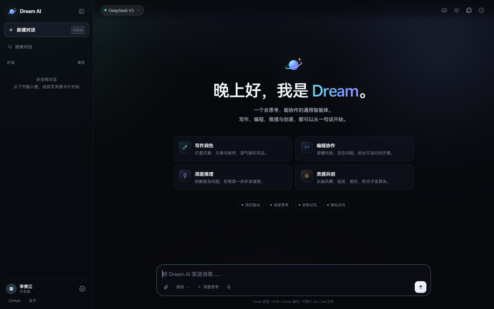
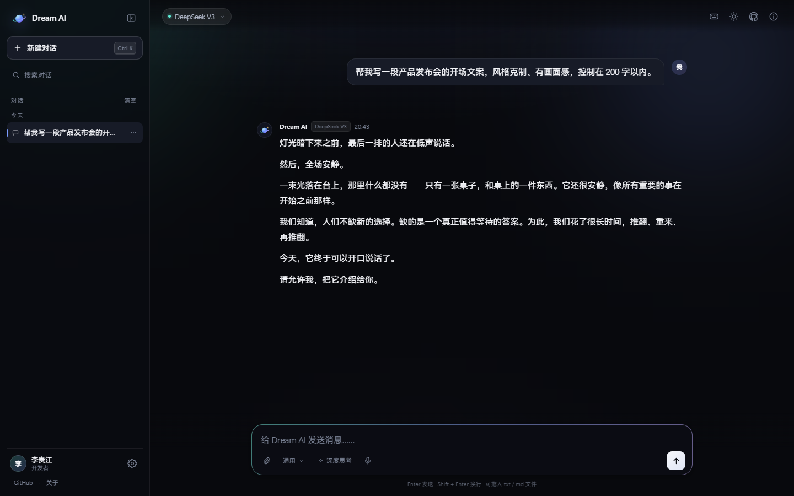
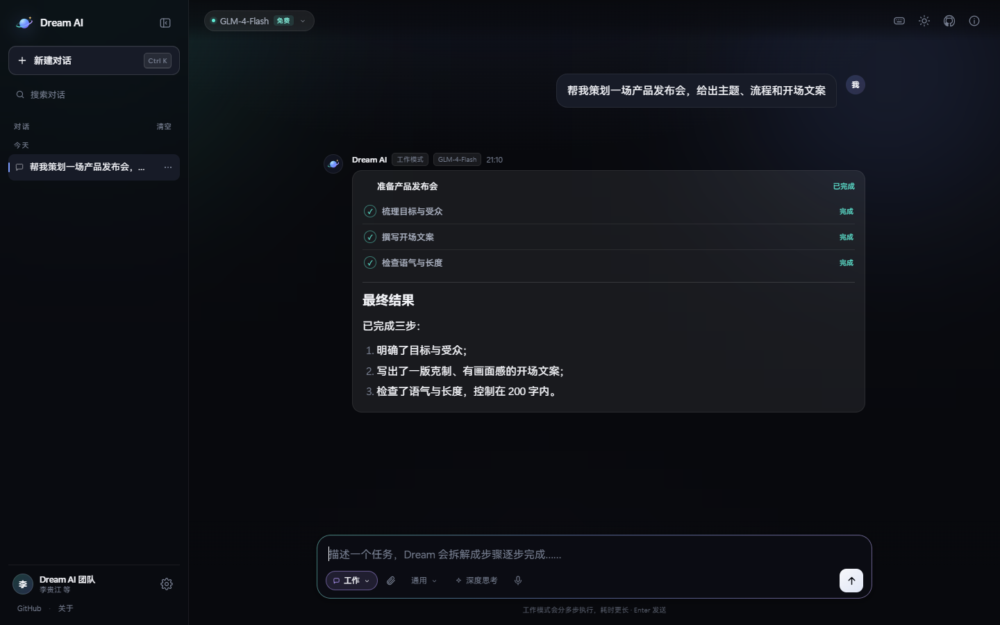
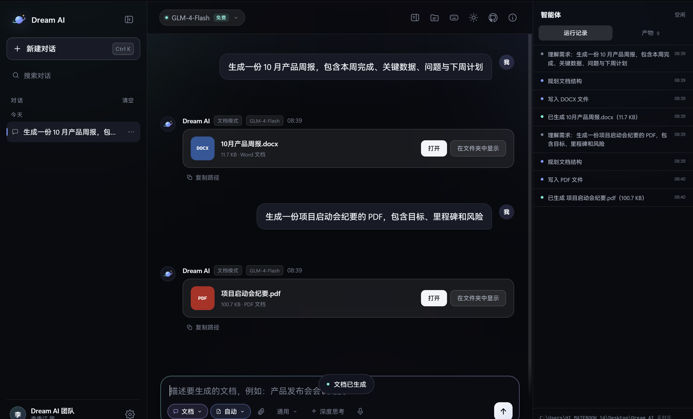
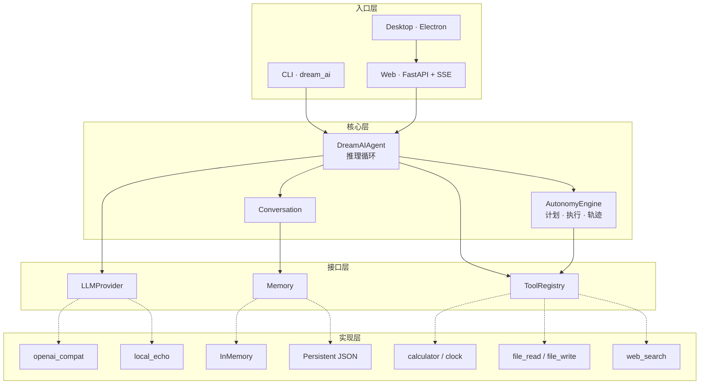

<p align="center">
  
</p>

<h1 align="center">Dream AI</h1>

<p align="center">
  <b>一个会思考、能协作的通用智能体</b><br>
  写作 · 编程 · 推理 · 创意 —— 从一句话开始
</p>

<p align="center">
  <a href="https://liguijiang.com"></a>
  <a href="https://liguijiang.com/download.html"></a>
  <a href="./docs/README.md"></a>
</p>

<p align="center">
  <a href="https://github.com/Li-Guijiang/DreamAI/actions/workflows/ci.yml"></a>
  <a href="https://github.com/Li-Guijiang/DreamAI/releases"></a>
  <a href="./LICENSE"></a>
  <a href="./README.md"></a>
  <a href="https://github.com/Li-Guijiang/DreamAI/pkgs/container/dream-ai"></a>
  <a href="./docs/CONTRIBUTING.md"></a>
</p>

<p align="center">
  <sub><a href="./docs/GUIDE.md">中文上手指南</a> · <a href="./docs/ARCHITECTURE.md">架构设计</a> · <a href="./docs/ROADMAP.md">路线图</a> · <a href="./CHANGELOG.md">变更日志</a></sub>
</p>

---

## 目录

1. [项目简介](#1-项目简介)
2. [三种形态](#2-三种形态)
3. [界面预览](#3-界面预览)
4. [核心能力](#4-核心能力)
5. [架构](#5-架构)
6. [快速开始](#6-快速开始)
7. [命令与配置](#7-命令与配置)
8. [路线图](#8-路线图)
9. [目录结构](#9-目录结构)
10. [参与贡献](#10-参与贡献)

---

## 1. 项目简介

**Dream AI** 是一个从零开始构建的开源通用智能体。它会推理、会记忆、会调用工具、会为多步目标制定计划，并按阶段逐步长成一个能真正替人做事的助手。

项目由一个信念支撑：智能应当属于所有人。因此代码以 MIT 许可开放，模型后端可替换——任何 OpenAI 兼容端点、本地开源模型都能接入，核心不绑定任何厂商。

> Dream AI is an open-source, general-purpose AI assistant built around one shared dream: helping people everywhere think clearly, reason deeply, and create freely.

> **状态：早期开发中（WIP）。** 功能按阶段推进，下文标注为计划的部分尚未实现。当前进度与验收标准见 [路线图](./docs/ROADMAP.md)。

三种形态共用一套设计语言与 `DREAMAI_*` 配置约定：

| 形态 | 入口 | 版本 | 适用场景 |
|---|---|---|---|
| 命令行包 | `python -m dream_ai` · [`dream_ai/`](./dream_ai) | `0.4.0` | 本地脚本、自动化、二次开发 |
| Web 服务 | <https://liguijiang.com> · [`web/`](./web) | `1.4.0` | 打开即用，无需安装 |
| Windows 桌面端 | [下载页](https://liguijiang.com/download.html) · [`desktop/`](./desktop) | `1.2.0` | 本地文件工作台、文档生成、编程模式 |

三个版本号各自独立，是设计决定而非遗漏：原因见 [版本号对照](./docs/README.md#3-版本号对照) 与 [ADR 0001](./docs/adr/0001-three-deliverables-one-repository.md)。

## 2. 三种形态

| 模式 | 行为 | 适合 |
|---|---|---|
| **对话** | 一次提问，一次回答 | 写作、问答、翻译、代码片段 |
| **工作** | 先拆 3–6 步计划，逐步执行，最后汇总 | 调研、策划、多步骤任务 |
| **编程**（桌面端） | 建项目、写文件、装依赖、把服务跑起来；命令执行前需确认 | 从零搭一个小项目 |

## 3. 界面预览

| 首页 | 对话 |
|---|---|
|  |  |

| 工作模式 | 桌面端 |
|---|---|
|  |  |

## 4. 核心能力

| 能力 | 说明 | 版本 |
|---|---|---|
| **可替换后端** | 任何 OpenAI 兼容端点（OpenAI / DeepSeek / 智谱 / Ollama / LM Studio），核心不感知厂商 | v0.1 |
| **会话记忆** | 历史落盘为 JSON，重启自动恢复；离线占位回复不会写入历史 | v0.2 |
| **长期偏好** | `/remember` 记下的偏好注入 system 消息，跨会话生效 | v0.2 |
| **工具层** | 注册表带参数 schema、风险等级与二次确认；内置计算器、时钟、沙箱文件读写、联网搜索 | v0.3 |
| **自主规划** | think → act → observe → reflect 循环，带步数预算、失败重试、保护动作确认、全程轨迹 | v0.4 |
| **流式输出** | Web 端基于 SSE 逐字返回，思考过程可折叠查看 | web |
| **文档生成** | 桌面端可导出 docx / xlsx / pptx / pdf | desktop |
| **安全默认** | 工具与自主动作默认需显式确认；文件工具限制在沙箱目录内 | v0.3 |

## 5. 架构



核心只依赖三个窄接口（`LLMProvider` / `Memory` / `Tool`），因此换模型、换存储、加工具都不需要改 agent。分层细节与两条完整数据流见 [架构文档](./docs/ARCHITECTURE.md)。

## 6. 快速开始

### 6.1 命令行（三步）

```bash
git clone https://github.com/Li-Guijiang/DreamAI.git && cd DreamAI
python -m venv .venv && source .venv/bin/activate   # Windows: .venv\Scripts\activate
pip install -e . && python -m dream_ai
```

没有 API Key 也能启动：会进入**离线演示模式**，回复由占位实现生成，用来熟悉命令与流程。接入真实模型只需复制配置并填入 Key：

```bash
cp .env.example .env      # Windows: copy .env.example .env
# 编辑 .env，填写 DREAMAI_API_KEY / DREAMAI_BASE_URL / DREAMAI_MODEL
```

分步说明见 [安装指南](./docs/SETUP.md)，中文逐步讲解见 [上手指南](./docs/GUIDE.md)。

### 6.2 容器

```bash
docker pull ghcr.io/li-guijiang/dream-ai:latest
docker run -it --rm -e DREAMAI_API_KEY=your-key ghcr.io/li-guijiang/dream-ai:latest
```

### 6.3 Web 与桌面端

```bash
cd web && pip install -r requirements.txt && uvicorn app.main:app --port 8000   # Web
cd desktop && pnpm install && pnpm start                                        # 桌面端
```

## 7. 命令与配置

<details>
<summary><b>会话内命令</b>（点击展开）</summary>

| 命令 | 作用 |
|---|---|
| `/help` | 列出全部命令 |
| `/run <objective>` | 运行一次多步自主任务，打印计划与结果 |
| `/trace` | 查看上一次自主任务的计划、步骤状态与完整轨迹 |
| `/tools` | 列出已注册工具、风险等级与必需参数 |
| `/tool <name> <json>` | 直接调用工具，如 `/tool calculator {"expression": "2 * (3 + 4)"}` |
| `/remember <text>` | 记入长期偏好 |
| `/memory` | 查看已记住的偏好 |
| `/forget` | 清空长期偏好 |
| `/clear` | 清空当前会话历史 |
| `/about` | 显示后端、工具数、自主模式状态与偏好统计 |

</details>

<details>
<summary><b>环境变量</b>（点击展开，完整清单见 <code>.env.example</code>）</summary>

| 变量 | 默认值 | 作用 |
|---|---|---|
| `DREAMAI_PROVIDER` | `openai_compat` | 后端类型：`openai_compat` / `local` |
| `DREAMAI_BASE_URL` | `https://api.deepseek.com/v1` | 任意 OpenAI 兼容端点 |
| `DREAMAI_API_KEY` | 空 | 为空时进入离线演示模式 |
| `DREAMAI_MODEL` | `deepseek-chat` | 模型名称 |
| `DREAMAI_PERSISTENCE` | `true` | 是否把会话与偏好落盘 |
| `DREAMAI_DATA_DIR` | `~/.dream_ai` | 数据目录 |
| `DREAMAI_TOOLS_ENABLED` | `true` | 工具注册表总开关 |
| `DREAMAI_FILE_ACCESS_ENABLED` | `false` | 沙箱文件读写 |
| `DREAMAI_WEB_SEARCH_ENABLED` | `false` | 联网搜索 |
| `DREAMAI_WORKSPACE_DIR` | `<data_dir>/workspace` | 文件沙箱根目录 |
| `DREAMAI_AUTONOMY_ENABLED` | `true` | 自主模式总开关 |
| `DREAMAI_MAX_STEPS` | `10` | 单次任务的工具调用预算 |
| `DREAMAI_MAX_RETRIES` | `2` | 每步失败后的额外重试次数 |
| `DREAMAI_AUTONOMY_VERBOSE` | `false` | 实时打印每个阶段事件 |

</details>

## 8. 路线图

| 版本 | 里程碑 | 目标 | 状态 |
|---|---|---|---|
| `v0.1.0` | Conversation | 打通可替换后端的对话闭环 | 已发布 |
| `v0.2.0` | Memory | 会话与偏好跨重启恢复 | 已发布 |
| `v0.3.0` | Tools | 安全工具层与确认机制 | 已发布 |
| `v0.4.0` | Autonomy | 多步规划与可复盘的执行轨迹 | 已发布 |
| `v1.0.0` | Stable Assistant | 可靠的个人通用智能体 | 进行中 |
| `Future` | Self-hosted | 本地开源模型完全自主部署 | 规划中 |

每一阶段的任务清单与验收标准见 [ROADMAP.md](./docs/ROADMAP.md)。

## 9. 目录结构

```
DreamAI/
├── dream_ai/                  # 命令行包（PyPI: dream-ai）
│   ├── cli.py                 # 命令解析与会话循环
│   ├── config.py              # 环境变量 → Settings
│   ├── agent_factory.py       # 按配置组装 agent
│   ├── core/                  # Agent 与 Conversation
│   ├── providers/             # 可替换的模型后端
│   ├── memory/                # 会话、偏好、原子化落盘
│   ├── tools/                 # 注册表、内置工具、调用解析
│   └── autonomy/              # 规划器、执行引擎、轨迹模型
├── web/                       # Web 服务与静态站
│   ├── app/                   # FastAPI（配置 / 流式客户端 / 路由）
│   ├── web/                   # 浏览器端资源
│   ├── deploy/                # nginx 与 systemd 模板
│   ├── tools/                 # 维护脚本（见 tools/README.md）
│   └── docs/                  # 文档截图
├── desktop/                   # Electron 桌面端
│   ├── electron/              # 主进程、preload 桥、本地工具
│   ├── test/                  # Node 测试与 E2E 辅助
│   └── build/                 # 打包资源（应用图标）
├── docs/                      # 文档，入口见 docs/README.md
│   └── adr/                   # 架构决策记录
├── tests/                     # pytest 用例
├── examples/                  # 可运行示例
├── assets/                    # 品牌资源（见 assets/README.md）
├── .github/workflows/         # CI / Release / PyPI / 容器
├── Dockerfile                 # 容器镜像定义
├── .editorconfig              # 编辑器缩进与编码约定
├── pyproject.toml             # 打包元数据、依赖、工具配置
├── CHANGELOG.md               # 变更历史
└── LICENSE                    # MIT
```

## 10. 参与贡献

欢迎 issue、建议与 pull request。开始之前请阅读 [贡献指南](./docs/CONTRIBUTING.md) 与 [行为准则](./docs/CODE_OF_CONDUCT.md)；遇到使用问题先看 [获取帮助](./docs/SUPPORT.md)，安全问题请按 [SECURITY.md](./docs/SECURITY.md) 私下报告。

提交前在本地跑一遍与 CI 相同的检查：

```bash
pytest
ruff check dream_ai tests examples web/app web/tools
ruff format --check dream_ai tests examples
```

| 文档 | 内容 |
|---|---|
| [docs/README.md](./docs/README.md) | 全部文档的索引与版本号对照 |
| [docs/GUIDE.md](./docs/GUIDE.md) | 中文上手指南：逐条命令与常见报错 |
| [docs/ARCHITECTURE.md](./docs/ARCHITECTURE.md) | 分层设计、模块职责、数据流 |
| [docs/ROADMAP.md](./docs/ROADMAP.md) | 阶段任务与验收标准 |
| [docs/SUPPORT.md](./docs/SUPPORT.md) | 遇到问题时的自查顺序与反馈渠道 |
| [web/README.md](./web/README.md) | Web 功能、接口、部署 |
| [desktop/README.md](./desktop/README.md) | 桌面端开发、打包、安全模型 |

---

<p align="center">
  <sub>MIT License · Copyright (c) 2026 Li Guijiang · 由李贵江等人组成的团队开发与维护</sub><br>
  <sub><i>From a shared dream to a world that understands itself — one step at a time.</i></sub>
</p>
