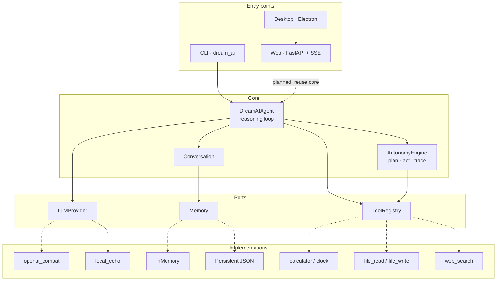

<p align="center">
  
</p>

<h1 align="center">Dream AI</h1>

<p align="center">
  <b>A general-purpose agent that thinks, remembers, and works with you</b><br>
  Writing · coding · reasoning · creative work — starting from one sentence
</p>

<p align="center">
  <a href="https://liguijiang.com"></a>
  <a href="https://liguijiang.com/download.html"></a>
  <a href="./docs/README.md"></a>
</p>

<p align="center">
  <a href="https://github.com/Li-Guijiang/DreamAI/actions/workflows/ci.yml"></a>
  <a href="https://github.com/Li-Guijiang/DreamAI/releases"></a>
  <a href="./LICENSE"></a>
  <a href="./README.md"></a>
  <a href="https://github.com/Li-Guijiang/DreamAI/pkgs/container/dream-ai"></a>
  <a href="./docs/CONTRIBUTING.md"></a>
</p>

<p align="center">
  <sub><a href="./docs/GUIDE.md">Getting started</a> · <a href="./docs/ARCHITECTURE.md">Architecture</a> · <a href="./docs/ROADMAP.md">Roadmap</a> · <a href="./CHANGELOG.md">Changelog</a></sub>
</p>

---

## Contents

1. [About](#1-about)
2. [Three deliverables](#2-three-deliverables)
3. [Screenshots](#3-screenshots)
4. [Capabilities](#4-capabilities)
5. [Architecture](#5-architecture)
6. [Quick start](#6-quick-start)
7. [Commands and configuration](#7-commands-and-configuration)
8. [Roadmap](#8-roadmap)
9. [Repository layout](#9-repository-layout)
10. [Contributing](#10-contributing)

---

## 1. About

**Dream AI** is an open-source general-purpose agent built from scratch. It reasons, remembers, calls tools, and plans multi-step goals — growing, phase by phase, into an assistant that can actually do the work for you.

The project rests on one belief: intelligence should belong to everyone. The code is MIT-licensed, the model backend is replaceable — any OpenAI-compatible endpoint or a local open-source model — and nothing in the core is tied to a vendor.

> **Status: early development (WIP).** Capabilities ship phase by phase; anything described below as planned is not implemented yet. Current progress and acceptance criteria live in the [roadmap](./docs/ROADMAP.md).

Three deliverables share one design language and one set of `DREAMAI_*` conventions:

| Form | Entry point | Version | Best for |
|---|---|---|---|
| Command-line package | `python -m dream_ai` · [`dream_ai/`](./dream_ai) | `0.4.0` | Local scripts, automation, extending the core |
| Web service | <https://liguijiang.com> · [`web/`](./web) | `2.0.0` | Open and use, nothing to install; full cosmic motion system + animated docs at `/docs.html` |
| Windows desktop app | [Download](https://liguijiang.com/download.html) · [`desktop/`](./desktop) | `1.3.0` | Local file workbench, document generation, coding mode, in-app update |

The three version numbers are independent by design, not by drift: see the [version cross-reference](./docs/README.md#3-version-cross-reference) and [ADR 0001](./docs/adr/0001-three-deliverables-one-repository.md).

## 2. Three deliverables

| Mode | Behaviour | Best for |
|---|---|---|
| **Chat** | One question, one answer | Writing, Q&A, translation, code snippets |
| **Work** | Drafts a 3–6 step plan, executes it, then summarises | Research, planning, multi-step tasks |
| **Code** (desktop) | Scaffolds a project, writes files, installs dependencies, starts the server; every command asks for approval | Building a small project from zero |

## 3. Screenshots

| Home | Chat |
|---|---|
|  |  |

| Work mode | Desktop |
|---|---|
|  |  |

<sub>图片由 GitHub 内置附件托管，避免仓库内图片域名不可达造成空白；若仍在加载，可直接访问 [liguijiang.com](https://liguijiang.com)。</sub>

### A site that moves

<p align="center"></p>

The web surface is now a living cosmic interface: a starfield that follows the
pointer, a warp intro, a greeting that types and deletes itself, a terminal
prompt ticker, orbital cards with 3D spotlight, magnetic buttons, click sparks,
page transitions, scroll reveals and reading progress. Every effect can be
switched off in one click or via `prefers-reduced-motion`.

| Motion documentation | Motion download page |
|---|---|
|  |  |

The CLI has its own quieter motion layer: a launch wordmark, typed replies, a
live thinking spinner and `/motion` to turn it off mid-session.

## 4. Capabilities

| Capability | What it does | Phase |
|---|---|---|
| **Replaceable backend** | Any OpenAI-compatible endpoint (OpenAI, DeepSeek, Zhipu, Ollama, LM Studio); the core never assumes a vendor | v0.1 |
| **Session memory** | History persisted as JSON and restored on restart; offline placeholder replies are filtered out | v0.2 |
| **Long-term preferences** | `/remember` writes into the system message, so it survives restarts | v0.2 |
| **Tool layer** | Registry with JSON Schema, risk level, and a confirmation gate; calculator, clock, sandboxed file access, web search | v0.3 |
| **Autonomous planning** | think → act → observe → reflect loop with a step budget, retries, approval before protected actions, and a full trace | v0.4 |
| **Streaming** | SSE token streaming on the web, with collapsible reasoning output | web |
| **Document generation** | Export docx / xlsx / pptx / pdf from the desktop app | desktop |
| **Living interface** | Shared web motion engine with a persistent on/off switch, reduced-motion support and a dedicated animated docs page | web 2.0 |
| **Terminal motion** | Launch sequence, typed replies, live spinner, coloured trace, `/motion`, and plain-text fallback for redirected output | v0.4 |
| **Safe by default** | Tools and autonomous actions require explicit approval; file tools stay inside a sandbox directory | v0.3 |

## 5. Architecture



The core depends on three narrow interfaces (`LLMProvider`, `Memory`, `Tool`), so swapping a model, a storage backend, or a tool never requires touching the agent. The web runtime currently has its own FastAPI streaming path (the dashed edge is planned work, not a shipped claim); the desktop app loads the web interface. Layer-by-layer detail and both data flows: [architecture](./docs/ARCHITECTURE.md).

## 6. Quick start

### 6.1 Command line (three steps)

```bash
git clone https://github.com/Li-Guijiang/DreamAI.git && cd DreamAI
python -m venv .venv && source .venv/bin/activate   # Windows: .venv\Scripts\activate
pip install -e . && python -m dream_ai
```

No API key needed to start: Dream AI falls back to **offline demo mode**, where replies come from a placeholder provider — enough to explore the commands and the loop. To connect a real model, copy the sample configuration and fill in your key:

```bash
cp .env.example .env      # Windows: copy .env.example .env
# edit .env: DREAMAI_API_KEY / DREAMAI_BASE_URL / DREAMAI_MODEL
```

Step-by-step installation: [SETUP.md](./docs/SETUP.md). A guided walkthrough: [GUIDE.md](./docs/GUIDE.md).

### 6.2 Container

```bash
docker pull ghcr.io/li-guijiang/dream-ai:latest
docker run -it --rm -e DREAMAI_API_KEY=your-key ghcr.io/li-guijiang/dream-ai:latest
```

### 6.3 Web and desktop

```bash
cd web && pip install -r requirements.txt && uvicorn app.main:app --port 8000   # Web
cd desktop && pnpm install && pnpm start                                        # Desktop
```

## 7. Commands and configuration

<details>
<summary><b>In-chat commands</b> (click to expand)</summary>

| Command | Action |
|---|---|
| `/help` | List every command |
| `/run <objective>` | Run a multi-step autonomous task and print the plan and result |
| `/trace` | Show the plan, step statuses, and full trace of the last task |
| `/tools` | List registered tools with risk level and required arguments |
| `/tool <name> <json>` | Call a tool directly, e.g. `/tool calculator {"expression": "2 * (3 + 4)"}` |
| `/remember <text>` | Store a long-term preference |
| `/memory` | Show remembered preferences |
| `/forget` | Clear all remembered preferences |
| `/clear` | Clear the current conversation |
| `/motion` | Toggle the terminal launch / typing / spinner effects for this session |
| `/about` | Show backend, tool count, autonomy status, and preference count |

</details>

<details>
<summary><b>Environment variables</b> (click to expand; full list in <code>.env.example</code>)</summary>

| Variable | Default | Purpose |
|---|---|---|
| `DREAMAI_PROVIDER` | `openai_compat` | Backend type: `openai_compat` or `local` |
| `DREAMAI_BASE_URL` | `https://api.deepseek.com/v1` | Any OpenAI-compatible endpoint |
| `DREAMAI_API_KEY` | empty | Empty switches to offline demo mode |
| `DREAMAI_MODEL` | `deepseek-chat` | Model name |
| `DREAMAI_PERSISTENCE` | `true` | Persist conversation and preferences |
| `DREAMAI_DATA_DIR` | `~/.dream_ai` | Data directory |
| `DREAMAI_TOOLS_ENABLED` | `true` | Master switch for the tool registry |
| `DREAMAI_FILE_ACCESS_ENABLED` | `false` | Sandboxed file read/write |
| `DREAMAI_WEB_SEARCH_ENABLED` | `false` | Web search |
| `DREAMAI_WORKSPACE_DIR` | `<data_dir>/workspace` | File sandbox root |
| `DREAMAI_AUTONOMY_ENABLED` | `true` | Master switch for autonomous mode |
| `DREAMAI_MAX_STEPS` | `10` | Tool-call budget per task |
| `DREAMAI_MAX_RETRIES` | `2` | Extra retries per failed step |
| `DREAMAI_AUTONOMY_VERBOSE` | `false` | Print every phase event live |
| `DREAMAI_ANIMATIONS` | `auto` | Terminal motion: `auto` only in a real TTY, `false` forces plain text |
| `DREAMAI_ANIMATION_SPEED` | `1.0` | Motion speed multiplier (`0.25`–`4.0`) |

</details>

## 8. Roadmap

| Version | Milestone | Goal | Status |
|---|---|---|---|
| `v0.1.0` | Conversation | A working loop through a replaceable backend | Released |
| `v0.2.0` | Memory | Sessions and preferences survive restarts | Released |
| `v0.3.0` | Tools | A safe tool layer with a confirmation gate | Released |
| `v0.4.0` | Autonomy | Multi-step planning with a reviewable trace | Released |
| `web 2.0.0` | Living web surface | Full motion system, animated docs page, accessible motion switch | Live |
| `v1.0.0` | Stable assistant | A reliable general-purpose personal agent | In progress |
| `Future` | Self-hosted | Fully local deployment on open-source models | Planned |

Task lists and acceptance criteria per phase: [ROADMAP.md](./docs/ROADMAP.md).

## 9. Repository layout

```
DreamAI/
├── dream_ai/                  # CLI package (PyPI: dream-ai)
│   ├── cli.py                 # Argument parsing and the chat loop
│   ├── config.py              # Environment → Settings
│   ├── agent_factory.py       # Builds the agent from settings
│   ├── core/                  # Agent and Conversation
│   ├── providers/             # Replaceable model backends
│   ├── memory/                # Sessions, preferences, atomic persistence
│   ├── tools/                 # Registry, built-in tools, call parser
│   ├── autonomy/              # Planner, execution engine, trace models
│   └── ui/                    # Terminal launch / typing / spinner effects
├── web/                       # Web service and static site
│   ├── app/                   # FastAPI (config / streaming client / routes)
│   ├── web/                   # Browser assets
│   ├── deploy/                # nginx and systemd templates
│   ├── tools/                 # Maintenance scripts (see tools/README.md)
│   └── docs/                  # Screenshots used by the documentation
├── desktop/                   # Electron desktop client
│   ├── electron/              # Main process, preload bridge, local tools
│   ├── test/                  # Node tests and E2E helpers
│   └── build/                 # Packaging resources (application icon)
├── docs/                      # Documentation, entry point: docs/README.md
│   └── adr/                   # Architecture Decision Records
├── tests/                     # pytest suite
├── examples/                  # Runnable examples
├── assets/                    # Brand assets (see assets/README.md)
├── .github/workflows/         # CI / Release / PyPI / container
├── Dockerfile                 # Container image definition
├── .editorconfig              # Editor indentation and encoding rules
├── pyproject.toml             # Packaging metadata, dependencies, tool config
├── CHANGELOG.md               # Versioned change history
└── LICENSE                    # MIT
```

## 10. Contributing

Issues, suggestions, and pull requests are welcome. Read the [contributing guide](./docs/CONTRIBUTING.md) and the [code of conduct](./docs/CODE_OF_CONDUCT.md) first; for usage questions start with [SUPPORT.md](./docs/SUPPORT.md), and report vulnerabilities privately as described in [SECURITY.md](./docs/SECURITY.md).

Run the same checks as CI before opening a pull request:

```bash
pytest
ruff check dream_ai tests examples web/app web/tools
ruff format --check dream_ai tests examples
for file in web/web/assets/js/*.js; do node --check "$file"; done
```

| Document | Contents |
|---|---|
| [docs/README.md](./docs/README.md) | Index of every document and the version cross-reference |
| [docs/GUIDE.md](./docs/GUIDE.md) | Guided walkthrough: setup, every command, common errors |
| [docs/ARCHITECTURE.md](./docs/ARCHITECTURE.md) | Layers, module responsibilities, data flow |
| [docs/ROADMAP.md](./docs/ROADMAP.md) | Phase tasks and acceptance criteria |
| [docs/SUPPORT.md](./docs/SUPPORT.md) | Self-check order and where to ask for help |
| [web/README.md](./web/README.md) | Web features, API, deployment |
| [desktop/README.md](./desktop/README.md) | Desktop development, packaging, security model |

---

<p align="center">
  <sub>MIT License · Copyright (c) 2026 Li Guijiang · Designed, built and maintained by Li Guijiang</sub><br>
  <sub><i>From a shared dream to a world that understands itself — one step at a time.</i></sub>
</p>
