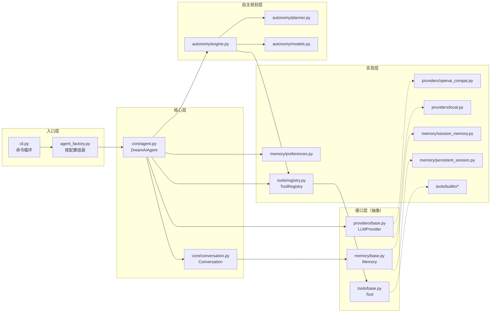
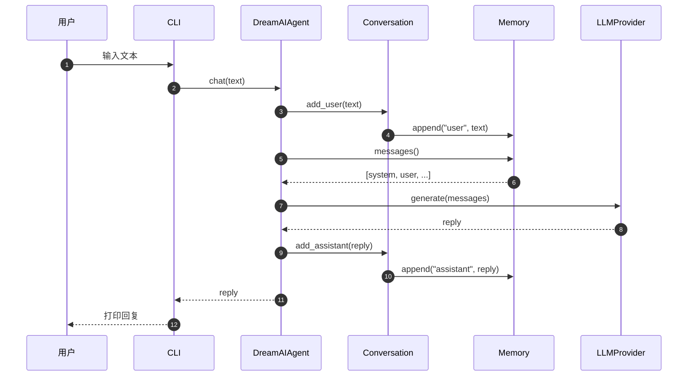
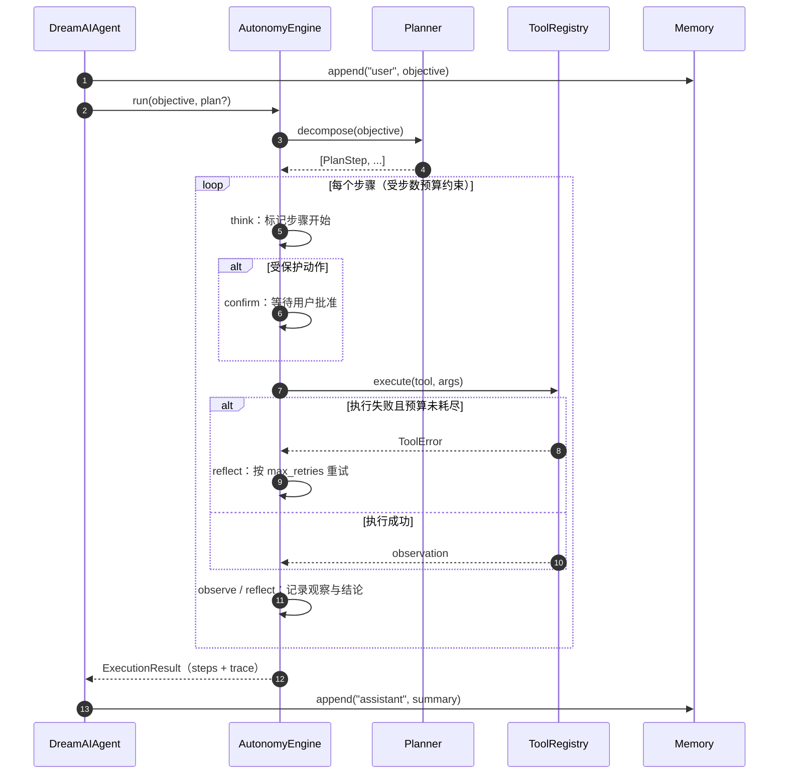

# 架构设计

[返回文档索引](./README.md)

Dream AI 的核心目标只有一个：**换模型、换存储、加工具时，不需要改 agent**。
本文说明这条约束是如何落到代码结构上的，以及一次对话、一次自主任务分别经过哪些环节。

---

## 1. 设计原则

1. **接口优先于实现。** 核心只依赖 `LLMProvider`、`Memory`、`Tool` 三个窄接口，不引用任何具体后端。
2. **厂商中立。** 没有一行核心逻辑假定某个模型供应商；OpenAI 兼容端点、本地模型都通过同一个接口接入。
3. **小部件、可替换。** 每层都能单独替换与测试，改一层不影响其它层。
4. **默认安全。** 涉及写入、沙箱、联网的工具，以及自主任务中的受保护动作，都必须显式确认并留痕。
5. **渐进暴露。** 简单用法保持简单；高级能力（文件、联网、自主规划）全部通过开关按需开启。

---

## 2. 模块关系

要点：`AutonomyEngine` 不直接调用工具实现，而是通过 `ToolRegistry` 执行，因此「自主调用」和「手动 `/tool` 调用」走的是同一条确认与错误处理路径。

---

## 3. 分层职责

### 3.1 入口层

- `cli.py`：解析参数、加载配置、构建 agent、跑会话循环。**不含业务逻辑**，只负责输入输出与命令分发。
- `agent_factory.py`：根据 `Settings` 选择记忆后端与工具集合，把依赖注入 `DreamAIAgent`。文件系统、权限开关的判断集中在这里，核心层因此保持干净。

### 3.2 核心层

- `core/agent.py`：组装 provider、memory、conversation、tools；对外暴露 `chat()`、`reset()`、`execute_tool()`、`autonomous_task()`。
- `core/conversation.py`：在 `Memory` 之上提供 `add_user` / `add_assistant` / `history` / `clear` 四个语义化操作，屏蔽消息细节。

### 3.3 接口层

| 接口 | 方法 | 约定 |
|---|---|---|
| `LLMProvider` | `name`、`generate(messages) -> str` | 输入有序消息列表，输出纯文本回复 |
| `Memory` | `append`、`messages`、`clear`、`set_system_prompt` | system 消息永远位于首位；`messages()` 返回副本 |
| `Tool` | `name`、`description`、`parameters`、`risk`、`requires_confirmation`、`run(**kwargs)` | `parameters` 为标准 JSON Schema，`risk` 为 `safe` / `protected` |

`Memory.set_system_prompt()` 是提示词唯一的下发通道：agent 在启动时、以及每次记住或清除偏好后调用它，保证发给 provider 的首条消息始终是最新提示词。

### 3.4 实现层

- **Provider**：`openai_compat.py` 走任意 OpenAI 兼容 HTTP 端点（`openai` 包延迟导入，离线可用）；`local.py` 是无网络的占位实现，用于测试与演示。
- **Memory**：`session_memory.py` 进程内缓冲；`persistent_session.py` 在其上叠加 JSON 落盘（原子写、只存对话轮次、过滤离线占位回复）；`preferences.py` 独立保存长期偏好。
- **Tools**：`registry.py` 负责注册与查找；`parser.py` 解析 `<<TOOL {...}>>` 文本块；`factory.py` 按权限开关装配；`builtin/` 提供计算器（AST 白名单，不用 `eval`）、时钟、沙箱文件读写、联网搜索。

### 3.5 自主规划层

- `models.py`：`PlanStep`、`TraceEntry`、`ExecutionResult` 与生命周期枚举，全部可序列化，供 CLI 展示与日志留存。
- `planner.py`：`Planner` 接口 + 确定性 `RuleBasedPlanner`；后续模型驱动的规划器实现同一接口即可替换。
- `engine.py`：think → act → observe → reflect 循环，负责步数预算、失败重试、保护动作确认、轨迹记录。

---

## 4. 数据流：一次对话

关键点：provider 收到的始终是 `Memory` 的完整快照，而不是 agent 内部的临时结构，因此记忆后端的替换对上层完全透明。

---

## 5. 数据流：一次自主任务

终止条件只有三种：全部步骤完成、步数预算耗尽、用户拒绝某个受保护动作。三种情况都会写入 `ExecutionResult.status`，并通过 `/trace` 可复盘。

---

## 6. 扩展点

### 6.1 新增模型后端

1. 在 `dream_ai/providers/` 新建类，实现 `LLMProvider`。
2. 实现 `name` 与 `generate()`。
3. 在 `providers/__init__.py` 的 `build_provider()` 中注册。

### 6.2 新增工具

1. 在 `dream_ai/tools/builtin/` 新建类，继承 `Tool`。
2. 实现 `name`、`description`、`parameters`、`run(**kwargs)`。
3. 声明 `risk` 与 `requires_confirmation`；只读工具保持 `safe`。
4. 在 `tools/factory.py` 中挂到对应的权限开关后面。

### 6.3 新增记忆后端

1. 实现 `Memory` 的四个方法：`append` / `messages` / `clear` / `set_system_prompt`。
2. 保持「system 消息在首位」与「`messages()` 返回副本」两条约定。
3. 注入 `Conversation` 与 `DreamAIAgent`，其余层无需改动。

### 6.4 新增规划器

1. 在 `dream_ai/autonomy/` 新建类，实现 `Planner.decompose(objective) -> list[PlanStep]`。
2. 传给 `AutonomyEngine(..., planner=你的规划器)`；循环、预算、重试、确认逻辑保持复用。

---

## 7. 现状与后续

1. v0.4 的规划器是确定性规则实现，只识别时间与计算意图；模型驱动的计划拆解与原生 function-calling 属于后续阶段，复用同一个引擎、轨迹、预算与确认机制。
2. **Web 服务目前没有复用 `dream_ai` 的 agent 循环**：`web/app/llm.py` 直接与模型端点通信，以实现 SSE 流式输出与思考过程透传。两者共用配置约定（`DREAMAI_*`）与提示词思路，但代码路径独立；把它们收敛到同一套 agent API 是后续重构的候选方向。
3. 桌面端加载 Web 界面，本身不实现对话逻辑，只通过 IPC 提供本地文件、文档生成与命令执行能力。
4. 本地开源模型接入通过新增 provider 完成，不需要改动核心。
