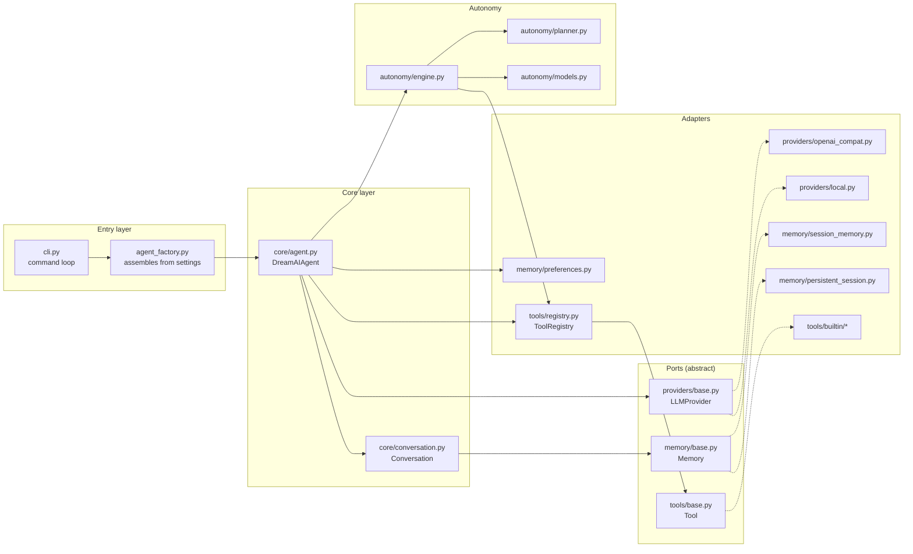
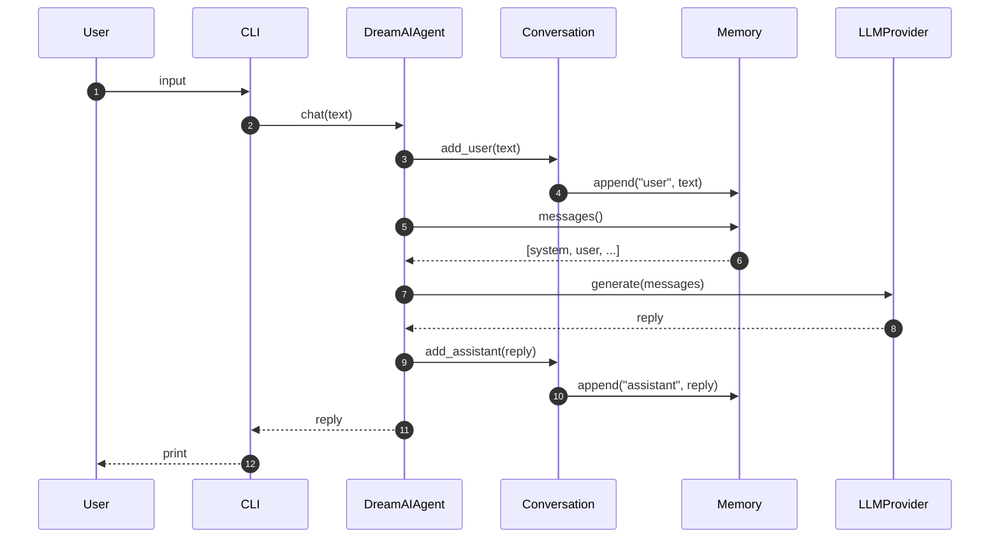
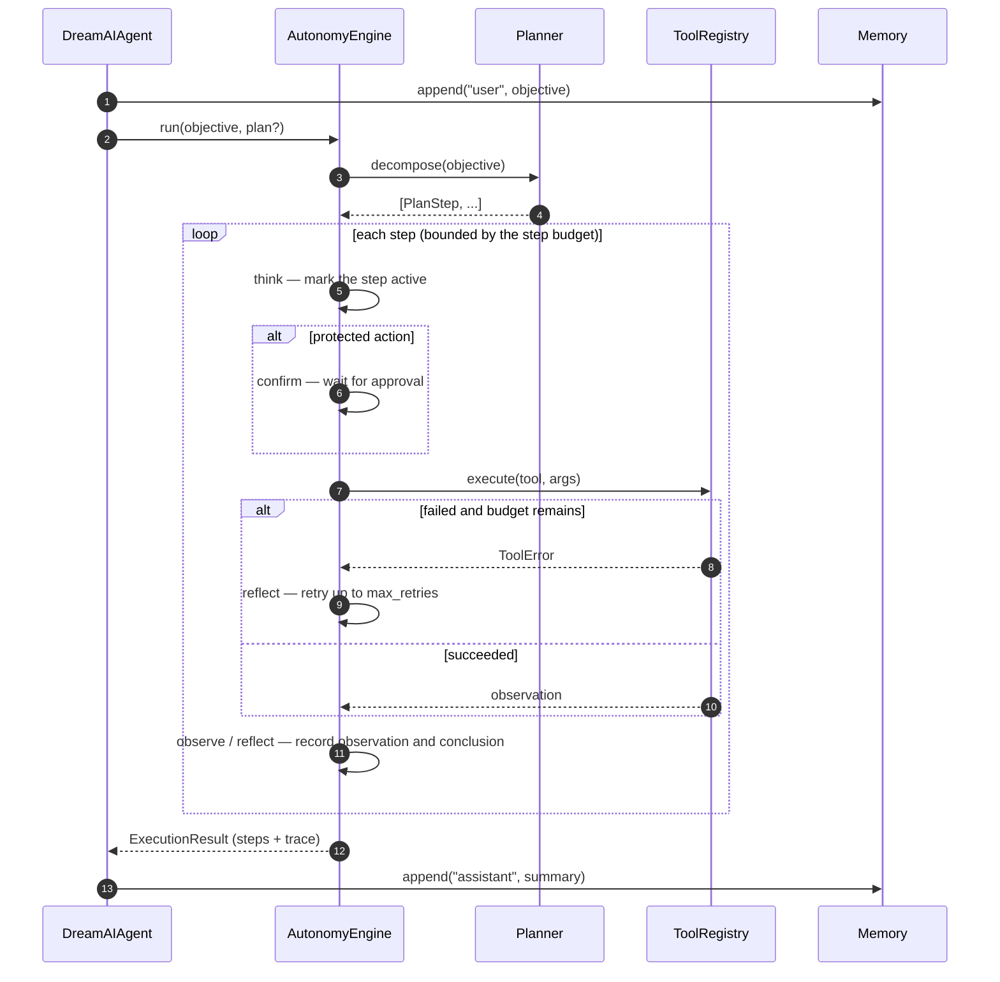

# Architecture

[Back to the documentation index](./README.md)

Dream AI has exactly one architectural constraint: **swapping a model, a storage backend, or a tool must never require changing the agent.** This page shows how that constraint maps onto the code, and what happens during a single chat turn and a single autonomous task.

---

## 1. Design principles

1. **Interfaces over implementations.** The core depends on three narrow contracts — `LLMProvider`, `Memory`, `Tool` — and never on a concrete backend.
2. **Vendor-neutral.** No core logic assumes a provider; OpenAI-compatible endpoints and local models enter through the same interface.
3. **Small, replaceable parts.** Every layer can be replaced and tested on its own.
4. **Safe by default.** Anything that writes, touches the sandbox, or reaches the network requires explicit approval and leaves a trace.
5. **Progressive disclosure.** Simple usage stays simple; advanced capabilities (files, web, autonomy) are opt-in switches.

---

## 2. Module map

Note that `AutonomyEngine` executes tools through `ToolRegistry`, not through the tool classes directly. That is why an autonomous call and a manual `/tool` call share the same confirmation gate and the same error handling.

---

## 3. Layers

### 3.1 Entry layer

- `cli.py` — parses arguments, loads settings, builds the agent, runs the loop. **No business logic**: it only handles input, output, and command dispatch.
- `agent_factory.py` — picks the memory backend and the tool set from `Settings` and injects them into `DreamAIAgent`. Filesystem and permission decisions are made here, which keeps the core clean.

### 3.2 Core layer

- `core/agent.py` — composes provider, memory, conversation, and tools; exposes `chat()`, `reset()`, `execute_tool()`, `autonomous_task()`.
- `core/conversation.py` — turns `add_user` / `add_assistant` / `history` / `clear` into a small vocabulary on top of `Memory`.

### 3.3 Ports

| Port | Methods | Contract |
|---|---|---|
| `LLMProvider` | `name`, `generate(messages) -> str` | Takes an ordered message list, returns plain text |
| `Memory` | `append`, `messages`, `clear`, `set_system_prompt` | The system message is always first; `messages()` returns a copy |
| `Tool` | `name`, `description`, `parameters`, `risk`, `requires_confirmation`, `run(**kwargs)` | `parameters` is JSON Schema; `risk` is `safe` or `protected` |

`Memory.set_system_prompt()` is the single path for the prompt: the agent calls it at start-up and after every remembered or cleared preference, so the first message the provider sees is always current.

### 3.4 Adapters

- **Providers** — `openai_compat.py` reaches any OpenAI-compatible HTTP endpoint (the `openai` package is imported lazily, so the package stays usable offline); `local.py` is a network-free placeholder for tests and demos.
- **Memory** — `session_memory.py` is an in-process buffer; `persistent_session.py` layers JSON persistence on top (atomic writes, turns only, offline placeholder replies filtered out); `preferences.py` stores long-term notes separately.
- **Tools** — `registry.py` registers and looks up tools; `parser.py` extracts `<<TOOL {...}>>` blocks; `factory.py` wires the permission switches; `builtin/` ships the calculator (AST allowlist, no `eval`), clock, sandboxed file read/write, and web search.

### 3.5 Autonomy

- `models.py` — `PlanStep`, `TraceEntry`, `ExecutionResult`, and the lifecycle enums. All serializable, for the CLI view and for logs.
- `planner.py` — the `Planner` interface plus a deterministic `RuleBasedPlanner`; a model-driven planner can implement the same interface later.
- `engine.py` — the think → act → observe → reflect loop: step budget, retries, approval for protected actions, and trace recording.

---

## 4. Data flow: one chat turn

The provider always receives a snapshot of `Memory`, never an internal structure of the agent, which is why the memory backend can be replaced without touching the caller.

---

## 5. Data flow: one autonomous task

A run can end in exactly three ways: every step completed, the step budget exhausted, or the user declined a protected action. All three are recorded in `ExecutionResult.status` and reviewable through `/trace`.

---

## 6. Extension points

### 6.1 Add a provider

1. Create a class implementing `LLMProvider` in `dream_ai/providers/`.
2. Implement `name` and `generate()`.
3. Register it in `build_provider()` inside `providers/__init__.py`.

### 6.2 Add a tool

1. Create a class extending `Tool` in `dream_ai/tools/builtin/`.
2. Implement `name`, `description`, `parameters`, and `run(**kwargs)`.
3. Declare `risk` and `requires_confirmation`; read-only tools stay `safe`.
4. Register it in `tools/factory.py` behind the matching permission switch.

### 6.3 Add a memory backend

1. Implement the four `Memory` methods: `append`, `messages`, `clear`, `set_system_prompt`.
2. Keep two rules: the system message comes first, and `messages()` returns a copy.
3. Inject it into `Conversation` and `DreamAIAgent`; nothing else changes.

### 6.4 Add a planner

1. Create a class in `dream_ai/autonomy/` implementing `Planner.decompose(objective) -> list[PlanStep]`.
2. Pass it to `AutonomyEngine(..., planner=your_planner)`; the loop, budget, retry, and confirmation logic are reused as-is.

---

## 7. Current state and next steps

1. The v0.4 planner is deterministic and only recognises time and calculation intents. Model-driven decomposition and native function calling belong to a later phase and reuse the same engine, trace, budget, and confirmation gate.
2. **The web service does not reuse the `dream_ai` agent loop.** `web/app/llm.py` talks to the endpoint directly so it can stream SSE tokens and forward reasoning output. The two share the `DREAMAI_*` conventions and the prompt design, but the code paths are separate; converging them on one agent API is a candidate refactor.
3. The desktop app loads the web interface and implements no chat logic itself: it only exposes local files, document generation, and command execution over IPC.
4. Local open-source models are added as another provider; the core does not change.
