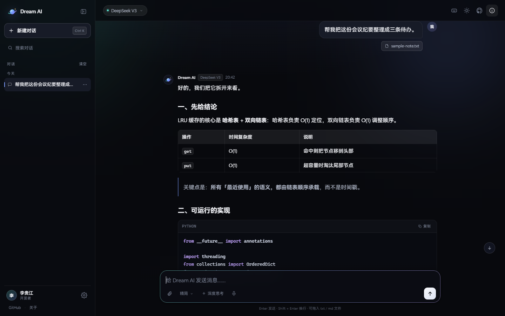

# Dream AI · Web

<p align="center"></p>

<sub>[Back to the repository home](../README.md) · [Documentation index](../docs/README.md)</sub>

> Every idea deserves to be taken seriously.

The web edition of Dream AI: a general-purpose agent you can use straight from a browser. It follows
the positioning and configuration conventions of the [DreamAI](https://github.com/Li-Guijiang/DreamAI)
repository (OpenAI-compatible providers, `DREAMAI_*` environment variables) and adds what a web
product actually needs — streaming output, visible reasoning, multi-turn sessions, mobile layout,
and a deliberately restrained interface.

- Live: <https://liguijiang.com>
- Source: <https://github.com/Li-Guijiang/DreamAI>
- Team: Li Guijiang and contributors


## Features

| | |
| --- | --- |
| **Streaming chat** | Server-Sent Events, buffering disabled in nginx, first token in about 0.7 s |
| **Chat and work modes** | Chat answers directly; work mode drafts a plan, executes it step by step, then summarises |
| **Desktop app** | Windows client with a local file workbench (organise / rename / export documents) |
| **Visible reasoning** | Supports `deepseek-reasoner`-style models; the reasoning trace collapses on demand |
| **Style presets** | Default / precise / creative / concise, adjusting tone and temperature in one click |
| **Attachment reading** | Drop or upload txt / md / csv / json / code files and send them with the prompt |
| **Voice input** | Browser speech recognition (Chrome / Edge), speaks straight into the composer |
| **Session management** | Saved locally: search, rename, export one session or all of them |
| **Message editing** | Edit a sent question and regenerate the answer |
| **Markdown rendering** | Headings, tables, quotes, code blocks with Prism highlighting and one-click copy |
| **Theme and type size** | Dark / light / follow system; compact, standard, and comfortable text sizes |
| **Responsive** | Two columns on desktop, drawer sidebar and safe-area handling on mobile |
| **Two model sources** | A free default model (GLM-4-Flash) or the visitor's own DeepSeek key for V3 / R1 |
| **Private deployment** | API keys live only in the server `.env`; the browser never receives them |
| **Abuse protection** | Per-IP sliding window, daily budget, concurrency semaphore, and input length checks |


## Chat mode and work mode

| | Chat mode | Work mode |
| --- | --- | --- |
| Best for | Writing, coding, Q&A, conversation | Planning, research, multi-step tasks |
| Behaviour | One answer | Drafts a 3–6 step plan, executes it, summarises |
| Interface | Plain messages | Expandable step cards, progress, final result |
| Latency | 1–3 s | Tens of seconds to a minute |

Work mode follows the plan → execute → summarise idea from the DreamAI repository: the model emits a
JSON plan, the front end calls the model for each step, and a final pass assembles the answer. Every
step's output can be expanded.




## Layout

```
web/
├─ app/                    # FastAPI service
│  ├─ main.py              # Routes, SSE, rate limiting, security headers
│  ├─ llm.py               # OpenAI-compatible streaming client (httpx)
│  └─ config.py            # Environment parsing
├─ web/                    # Static front end (no build step)
│  ├─ index.html
│  ├─ manifest.webmanifest
│  └─ assets/
│     ├─ css/app.css       # Design system
│     ├─ js/app.js         # Sessions, streaming render, Markdown, interactions
│     ├─ img/              # Brand icons, favicon, social card
│     └─ vendor/           # marked / DOMPurify / Prism (self-hosted)
├─ deploy/                 # Deployment scripts and templates
├─ tools/                  # Maintenance scripts (mock model, assets, SSH helper) — see tools/README.md
├─ requirements.txt
└─ .env.example
```

## Desktop app (Windows)

Download: <https://liguijiang.com/download.html> (the installer lives in `web/downloads/`).

The desktop app is the same interface plus a local file workbench:

- Organise a folder by file type (preview first, then confirm)
- Batch rename (shared prefix plus a sequence number, extensions preserved)
- Save the current conversation as Markdown

Packaging instructions are in the [desktop guide](../desktop/README.md).

## Run locally

Python 3.10 or newer.

```bash
python -m venv .venv
.venv/bin/pip install -r requirements.txt
cp .env.example .env        # fill in DREAMAI_FREE_API_KEY, or use the mock
.venv/bin/uvicorn app.main:app --host 127.0.0.1 --port 8000
```

Open <http://127.0.0.1:8000>.

No key yet? `tools/mock_upstream.py` serves a fixed Markdown answer so you can work on styling and
streaming:

```bash
.venv/bin/uvicorn mock_upstream:app --app-dir tools --port 8799
DREAMAI_FREE_API_KEY=test DREAMAI_FREE_BASE_URL=http://127.0.0.1:8799/v1 \
DREAMAI_FREE_MODEL=mock-glm \
  .venv/bin/uvicorn app.main:app --port 8000
```

## Two model sources

| Source | Description | Who pays |
| --- | --- | --- |
| **Free model** (default) | Provided by the site, Zhipu `GLM-4-Flash` by default; visitors use it instantly | The site owner (free quota, model can be swapped) |
| **Bring your own key** | Visitors paste their DeepSeek key in Settings → Model source and can switch to V3 / R1 | The visitor |

- The free model's key exists only in the server `.env`; the browser never sees it.
- A visitor's key stays in their browser `localStorage` and is forwarded per request; the server does
  not store it or log it.
- The free model has a global daily budget; BYOK requests do not consume it.

## Configuration

Everything lives in `.env` (full sample in [`.env.example`](.env.example)):

| Variable | Meaning | Default |
| --- | --- | --- |
| `DREAMAI_FREE_API_KEY` | Free-model key (Zhipu, SiliconFlow, …) | empty |
| `DREAMAI_FREE_BASE_URL` | OpenAI-compatible endpoint for the free model | `https://open.bigmodel.cn/api/paas/v4` |
| `DREAMAI_FREE_MODEL` | Free model name | `glm-4-flash` |
| `DREAMAI_BYOK_BASE_URL` | Endpoint used with a visitor's own key | `https://api.deepseek.com/v1` |
| `DREAMAI_BYOK_MODELS` | Selectable BYOK models, `id\|label\|reasoning` | DeepSeek V3 / R1 |
| `DREAMAI_SYSTEM_PROMPT` | Custom persona (single line) | see `config.py` |
| `DREAMAI_RATE_LIMIT` / `_WINDOW` | Requests per IP / window in seconds | 30 / 600 |
| `DREAMAI_DAILY_LIMIT` | Global daily cap for the free model (BYOK excluded) | 2000 (600 is a common choice) |
| `DREAMAI_MAX_CONCURRENCY` | Concurrent upstream requests | 6 |

## Deploying to a server

Target environment: a control panel stack with nginx and systemd, site directory
`/www/wwwroot/<domain>`.

```bash
# 1. Package locally (excluding the virtualenv and caches)
tar czf dreamai-web.tar.gz --exclude .venv --exclude __pycache__ --exclude .env \
    -C dreamai-web .

# 2. Upload and unpack
scp dreamai-web.tar.gz root@<server-ip>:/tmp/
ssh root@<server-ip> 'mkdir -p /tmp/dreamai-release && tar xzf /tmp/dreamai-web.tar.gz -C /tmp/dreamai-release'

# 3. One-shot deploy (backs up the old site, keeps /lsl, builds a venv, writes systemd and nginx)
ssh root@<server-ip> 'bash /tmp/dreamai-release/deploy/install.sh'
```

The deploy script:

1. archives the current site to `/www/backup/<domain>-site-<timestamp>.tar.gz`;
2. clears the site directory, **keeping `lsl`** (it aborts when `lsl` is missing unless `FORCE=1`);
3. creates `.venv` and installs dependencies from a regional mirror;
4. writes `dreamai-web.service` and starts it (two uvicorn workers on `127.0.0.1:8000`, override with `PORT`);
5. reuses the existing TLS certificate, writes the nginx config, and reloads;
6. calls `/api/health` as a health check.

> After the first deployment, edit `/www/wwwroot/<domain>/.env` on the server to set
> `DREAMAI_FREE_API_KEY`, then run `systemctl restart dreamai-web`.

Routine operations:

```bash
systemctl status dreamai-web
journalctl -u dreamai-web -f
nginx -t && nginx -s reload
```

### Deployment record (2026-10-25)

| | |
| --- | --- |
| Server | Alibaba Cloud Linux 3 · nginx 1.28 |
| Site directory | `/www/wwwroot/<domain>` |
| Service port | `127.0.0.1:8010` (8000 was taken by another project on the same host) |
| systemd unit | `dreamai-web` (enabled at boot) |
| TLS certificate | managed by the control panel, valid until 2027-01-05 |
| Previous site backup | kept under `/www/backup/` |
| nginx config backup | kept next to the original `.conf` with a timestamp suffix |

When cleaning the old site, `lsl/` and `.well-known/` were preserved (the latter for certificate
renewal); everything else was removed. Host addresses and absolute paths are intentionally omitted
from this repository.

## Request path

```
browser ──POST /api/chat──▶ nginx ──▶ FastAPI ──▶ OpenAI-compatible endpoint
   ▲                        │          │
   └──── SSE: meta/delta ───┘          └─ the key never leaves server memory
         reasoning/done/error
```

- The front end sends the whole conversation; the backend trims it to the last 30 messages / 60k
  characters and prepends the persona.
- Any provider that speaks `/chat/completions` works; switching models is a `.env` change.
- `reasoning_content` is streamed as its own event and rendered as a collapsible "thinking" block.

## Security and privacy

- API keys live only in the server `.env` (mode `600`) and never appear in front-end output.
- Conversations stay in the visitor's browser; the server writes nothing to disk and requires no login.
- All model output is sanitised with DOMPurify before rendering; links use `noopener noreferrer`.
- Responses carry CSP, `X-Frame-Options: DENY`, `nosniff`, and related headers.
- Per-IP rate limiting and a concurrency cap keep a public deployment from being hammered.

## Relationship to the DreamAI repository

`dream_ai/` in the repository is the command-line agent core (provider, memory, tools, autonomy).
The web edition reuses its product definition and configuration conventions and brings the
conversation layer into the browser. A later step is to connect `dream_ai.tools` and the `autonomy`
engine to the `/api/chat` tool events, so the web app gains web access, files, and multi-step tasks.
